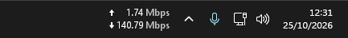
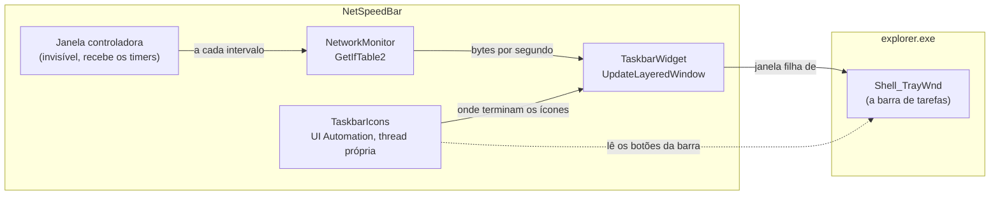

# NetSpeedBar



O NetSpeedBar mostra a velocidade de upload e download dentro da barra de tarefas do Windows 11, à esquerda dos ícones da bandeja do sistema. Ele ocupa o espaço livre da barra e não abre janela nem põe ícone na bandeja.

**[Baixar o instalador](https://github.com/vitor-brack/NetSpeedBar/releases/latest)** para Windows 11 de 64 bits. Não é preciso ter Java instalado.

## Por que existe

Até o Windows 10, programas como o NetSpeedMonitor mostravam a velocidade da internet na barra de tarefas usando DeskBands, um tipo de barra de ferramentas que o Windows 11 deixou de carregar. O NetSpeedBar traz essa informação de volta para o canto da barra no Windows 11, num programa que se instala uma vez e abre sozinho a cada login.

## Instalação

1. Na [página de Releases](https://github.com/vitor-brack/NetSpeedBar/releases/latest), baixe o `NetSpeedBar-Setup-<versão>.exe` da versão mais recente.
2. Abra o instalador. Como ele ainda não tem assinatura digital, o Windows pode mostrar a tela "O Windows protegeu o computador". Clique em **Mais informações** e depois em **Executar assim mesmo**.
3. Na última tela, deixe marcado **Abrir o NetSpeedBar agora**.

O instalador não pede senha de administrador, porque instala só para o seu usuário, em `%LOCALAPPDATA%\Programs\NetSpeedBar`. Ele também deixa o widget abrindo junto com o Windows. Para desligar isso, desmarque **Iniciar com o Windows** no menu do widget.

Para atualizar, abra o instalador da versão nova: ele fecha o widget, troca os arquivos e mantém as suas configurações. Para desinstalar, vá em Configurações > Aplicativos > Aplicativos instalados > NetSpeedBar. A desinstalação apaga também as configurações e o log.

## Como usar

Arraste o widget com o botão esquerdo para mudar a posição dele na barra. Ele vai para a esquerda até o último ícone dos aplicativos e não passa por cima deles. Se você abrir mais programas e os ícones chegarem até o widget, eles o empurram; quando os programas fecham, ele volta para onde você deixou.

O clique direito abre o menu:

| Opção | O que faz |
|---|---|
| Desde que abriu | Mostra o total baixado e enviado desde que o widget abriu |
| Placa de rede | **Automático** soma as placas físicas conectadas, como Ethernet e Wi-Fi, e deixa de fora as virtuais, como VPN e Hyper-V. Também dá para escolher uma placa específica |
| Unidade | Automático em bytes (KB/s, MB/s, GB/s), automático em bits (Kbps, Mbps, Gbps) ou uma unidade fixa, de B/s a GB/s ou de bps a Gbps |
| Atualizar a cada | 0.5 segundo, 1 segundo ou 2 segundos |
| Iniciar com o Windows | Liga ou desliga a abertura automática no login |
| Voltar à posição padrão | Aparece depois que você arrasta o widget e o devolve para perto da bandeja |
| Sair | Fecha o widget |

Os números sempre têm duas casas decimais. Nas unidades automáticas, a rede parada aparece como 0.00 KB/s (ou 0.00 Kbps), e a unidade só muda depois de 999.99. Nas unidades fixas aparece o separador de milhar, como em 12,345.67 KB/s, e o widget alarga para o número caber. Bytes usam base 1024, como o Windows, e bits usam base 1000, como os provedores de internet. O separador decimal é sempre o ponto e o de milhar é sempre a vírgula, qualquer que seja o idioma do Windows.

O texto segue o tema da barra: branco na barra escura e preto na clara.

## Stack

- Java 21
- [JNA](https://github.com/java-native-access/jna) 5.19 (`jna-platform`), que chama a API do Windows direto do Java, sem código em C
- Java2D para desenhar o texto
- Maven, com o `maven-shade-plugin` gerando um único `.jar` com o JNA dentro
- jpackage e jlink, que geram o `NetSpeedBar.exe` com um Java mínimo embutido
- [Inno Setup 6](https://jrsoftware.org/isinfo.php) para o instalador
- GitHub Actions, que gera o instalador das Releases com o Eclipse Temurin 21

## Como funciona



Uma janela invisível, a controladora, recebe os timers e os avisos do sistema. A cada intervalo, o `NetworkMonitor` lê os contadores de bytes das placas de rede e calcula a velocidade pela diferença entre duas leituras. O `TaskbarWidget` desenha os números numa janela que fica dentro da barra de tarefas. Quatro vezes por segundo ele confere se continua preso na barra e no lugar certo, e cria a janela de novo se a barra for recriada, como acontece quando o Explorer reinicia.

| Classe | O que faz |
|---|---|
| `NetSpeedBar` | Ponto de entrada, janela controladora, instância única e menu do clique direito |
| `TaskbarWidget` | A janela dentro da barra: posição, arraste e desenho |
| `TaskbarIcons` | Descobre onde ficam os botões da barra, para o widget não cobrir os ícones |
| `NetworkMonitor` | Lê os contadores das placas e calcula a velocidade |
| `SpeedFormat` | Formata números e unidades |
| `Settings` | Salva as preferências e liga ou desliga o início com o Windows |
| `Win32` | Funções e constantes da API do Windows que o `jna-platform` não traz |
| `Log` | Log em arquivo, já que com `javaw` não existe console |

## Como compilar

Precisa do JDK 21 ou mais novo (ele traz o jpackage), do Maven no PATH e do Inno Setup 6 (`winget install JRSoftware.InnoSetup`). O script acha o JDK pelo `JAVA_HOME` ou pelo `javac` no PATH.

```cmd
gerar-instalador.cmd
```

O instalador sai em `dist\NetSpeedBar-Setup-<versão>.exe`, com a versão do `<version>` do `pom.xml`. O script roda o Maven, monta o Java embutido com o jdeps e o jpackage e chama o Inno Setup com o `packaging\NetSpeedBar.iss`.

Para rodar sem instalar:

```cmd
mvn package
javaw -jar target\NetSpeedBar.jar
```

No NetBeans, basta abrir o projeto e rodar (F6). Só um NetSpeedBar roda por vez: abrir outro fecha o que estava aberto, inclusive a versão instalada. Fora da versão instalada, a opção **Iniciar com o Windows** não pode ser ligada, porque ela aponta para o `.exe` instalado.

Para ver as placas de rede que o Windows informa e quais delas aparecem no menu:

```cmd
java -jar target\NetSpeedBar.jar --interfaces
```

As Releases saem do GitHub Actions (`.github/workflows/release.yml`). Para publicar uma versão, mude o `<version>` do `pom.xml`, faça o commit e envie uma tag anotada com o mesmo número, como `git tag -a v1.0.1 -m "O que mudou"` e `git push origin v1.0.1`. O texto da tag vira a descrição da Release. Para só testar o build, rode o workflow pela aba Actions (**Release** > **Run workflow**): o instalador fica como artefato da execução.

## Decisões de projeto (e por quê)

### 1. Uma janela dentro da barra de tarefas

Como o Windows 11 não carrega DeskBands, o NetSpeedBar cria uma janela nativa como filha da `Shell_TrayWnd`, a janela da barra de tarefas, que pertence ao `explorer.exe`. Sendo filha, ela fica por cima do conteúdo XAML da barra, se move junto com a barra e some com ela em jogos e vídeos em tela cheia. O [TrafficMonitor](https://github.com/zhongyang219/TrafficMonitor) usa a mesma técnica.

### 2. Fundo transparente com alfa por pixel

A janela é do tipo *layered* e é pintada com `UpdateLayeredWindow`, com uma transparência para cada pixel. O fundo some e só o texto aparece, como se fizesse parte da barra. O Java2D desenha numa `BufferedImage` que usa o mesmo formato de pixel de um bitmap do Windows (BGRA pré-multiplicado), então os bytes vão para o bitmap sem conversão. O fundo tem alfa 1 de 255: é invisível, mas faz a área inteira receber o mouse, o que não aconteceria com alfa 0.

### 3. UI Automation para não cobrir os ícones

No Windows 11, os botões da barra são desenhados em XAML e não têm janelas próprias. A UI Automation, a API de acessibilidade que os leitores de tela usam, informa onde cada um está. O JNA não traz as interfaces COM da UI Automation, então o `TaskbarIcons` chama os métodos direto pela vtable. Cada consulta vai até o `explorer.exe` e leva uns 15 ms, por isso roda numa thread própria, a cada 2 segundos e no começo de cada arraste.

### 4. Números que não pulam

Com a rede parada, a escala automática mostraria "0 bps" e voltaria para "Kbps" no primeiro pacote, e o widget mudaria de largura o tempo todo. Por isso ela começa no K, todo número tem duas casas decimais e a unidade só muda depois de 999.99. As colunas de seta, número e unidade têm largura fixa, e a dos números só cresce.

### 5. Java embutido e enxuto

O jpackage gera o `NetSpeedBar.exe` com um Java mínimo, montado pelo jlink só com os módulos que o jdeps encontrou no `.jar`. O processo roda com `-Xmx64m` e o coletor de lixo serial. A DLL nativa do JNA vai ao lado do `.jar`, senão o JNA a extrairia na pasta TEMP a cada início.

### 6. Uma instância só, mesmo com administrador

Uma instância nova fecha a anterior mandando `WM_CLOSE` para a janela controladora dela. O Windows bloqueia essa mensagem quando a anterior roda como administrador, então cada instância a libera com `ChangeWindowMessageFilterEx`. O instalador fecha o widget do mesmo jeito antes de atualizar ou desinstalar. Quando o próprio instalador roda como administrador, ele abre o widget pelo `explorer.exe`, como usuário comum.

## Limitações

- O widget aparece só na barra do monitor principal.
- Foi testado no Windows 11, com tema escuro e escala de 100%.
- O instalador não tem assinatura digital, por isso o Windows mostra o aviso do SmartScreen.

## Privacidade

O NetSpeedBar não se conecta à internet e não envia dados. Ele só lê os contadores de bytes que o Windows já mantém para cada placa de rede. As preferências (`config.properties`) e o log (`netspeedbar.log`, que recomeça ao passar de 256 KB) ficam em `%LOCALAPPDATA%\NetSpeedBar`, e a desinstalação apaga essa pasta.

## Próximos passos

- Assinar o instalador de graça pela SignPath Foundation, para o aviso do SmartScreen sumir
- Perguntar no instalador se o widget deve iniciar com o Windows
- Mostrar o widget também nas barras dos outros monitores
- Testar com tema claro, outras escalas, barra que se oculta sozinha e Windows 10

## Licença

[MIT](LICENSE)
